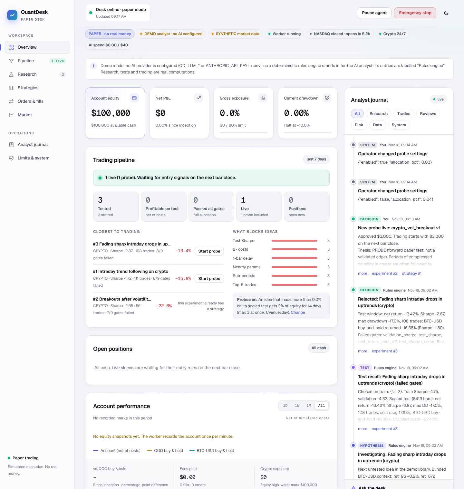

# QuantDesk: an autonomous AI research and paper-trading desk

An AI analyst that researches NASDAQ equities and liquid crypto on its own. It forms testable
hypotheses, backtests them with realistic costs on a sealed chronological test window, challenges
the results, and allocates **virtual** money only when deterministic gates pass. It then trades
through an independent risk engine and reviews live outcomes against what it expected. A live
journal explains every step, and you can ask it questions that it answers from its stored records.

**Paper trading only.** No code path sends orders to a broker. Starting capital is $100,000 of
virtual money.



---

## What you see

| Panel | Shows |
|---|---|
| Top bar | PAPER badge, analyst mode (AI model and provider, or **DEMO rules engine**), data mode, worker health, NASDAQ session and countdown, API spend vs. budget, Pause / Emergency stop |
| KPIs | Equity, P&L **after costs**, excess return vs. QQQ buy-and-hold, drawdown vs. limit, exposure, costs paid |
| Equity chart | Account vs. QQQ and BTC buy-and-hold of the same $100k |
| What I'm doing | Current activity, latest experiment, scheduled next actions |
| What I believe | Current views, each linked to the experiments or trades that support it (beliefs without verifiable evidence are discarded) |
| Positions | Click a row to see why it entered (written *before* the fill), the exact exit rules, and the exit plan |
| Research | Every experiment: hypothesis, frozen rules, train/validation/test split, metrics, stress tests, gate checklist, leakage notes, decision, lessons |
| Strategies | Live strategies: allocation, live return vs. expectation, slippage, reviews |
| Orders & fills | Intents (with rationale and risk-engine checks) kept separate from simulated fills (with the quote they hit) |
| Market | Candles with your fills marked, plus the live quote |
| Limits & system | Operator-only limits, controls, ledger integrity, sandbox isolation, LLM call audit (prompt and response), jobs, audit log |
| Journal + Ask | Live feed (server-sent events), filterable; questions are answered only from records, with citations |

## How the agent works

```
Observe ─► Investigate ─► Test ─► Challenge ─► Decide ─► Trade ─► Review
 stats     1 hypothesis   train→   cost×2,       gates +    risk     live vs.
 & changes + spec (DSL)   val→     +1 bar delay,  analyst    engine   expectation,
 (blinded)               FREEZE→  neighbours,    (reject/   → paper  shadow backtest,
                         test     sub-periods,    revise/    exchange continue/reduce/
                         (once)   concentration,  allocate)           retire
                                  deflated Sharpe
```

* **Observe** (`research/observe.py`): returns, volatility shifts, regime flips, new highs and
  outsized moves, all computed from stored bars. The context the LLM uses to *form* a hypothesis is
  **blinded**: it ends before the earliest possible test window, so nothing it has seen overlaps the
  test.
* **Investigate**: the analyst proposes one hypothesis (rationale, quantitative prediction,
  falsification criterion) plus a strategy spec in a small, causal expression language
  (`research/dsl.py`), for example `close > sma(close, slow) and market(close) > market(sma(close, 200))`.
  Saying "nothing worth testing" is a recorded decision. When the language can't express an idea,
  the model may write Python. That code runs in a **sandbox**, described below.
* **Test** (`research/experiment.py`): the parameter grid (≤ 12 combinations) is searched on
  **train only**, then confirmed on validation. The spec and chosen parameters are then **frozen and
  persisted**, and only after that is the sealed **test** window evaluated, exactly once. Fills
  happen at the next bar's open with half-spread, square-root market impact, venue fees and a cap
  on participation in average daily volume.
* **Challenge**: doubled costs, a one-bar execution delay, ±25 % parameter perturbations, four
  pre-test sub-periods, top-5-trade concentration, and a **Deflated Sharpe** (PSR against the
  expected maximum Sharpe of N zero-skill trials, where N counts earlier experiments whose test
  windows overlap this one).
* **Decide**: the gates in `research/gates.py` (operator-set thresholds) must all pass before any
  capital can be allocated. The analyst can always reject; an allocation request is capped by
  operator limits. New strategies start at an **incubation** size (50 % of approval).
* **Trade** (`trading/live.py`): on every newly closed bar, the frozen rules run through the
  **same** `compute_signals` and `step()` code as the backtester. Each order becomes an *intent*
  with a rationale built from actual rule values, then passes the independent risk engine, then
  fills in the paper exchange.
* **Review** (`agent/review.py`, daily): live P&L vs. the expected band from the test, a shadow
  backtest over the live period (implementation shortfall) and the recorded invalidation
  conditions. A breached drawdown limit always retires the strategy. Increases are allowed only
  after the minimum live period and only up to the approved amount.

"Learning" means the research memory. Each prompt includes prior experiments, their outcomes,
which gates failed and the recorded lessons, and revisions link to their parent experiment. The
Research tab is that record.

### NASDAQ vs. crypto

| | NASDAQ (Alpaca data) | Crypto (Coinbase public data) |
|---|---|---|
| Research bars | Daily, split- and dividend-adjusted, 6 years | Hourly, 3 years |
| Research schedule | At most once per new daily bar (every 20 h) | Every 4 h |
| Decisions | After the close (+20 min, after the free plan's SIP delay) | Each hourly close |
| Execution | Next regular session (+5 min), XNAS calendar with holidays and early closes | 24/7 |
| Costs | $0 commission (configurable), SEC fee + FINRA TAF on sells, quoted spread, impact | 25 bp taker fee, quoted spread, impact |
| Benchmark | QQQ | BTC-USD |

## Safeguards

* **Deterministic accounting** (`trading/ledger.py`): cash comes from an append-only ledger and
  positions are tracked per strategy. `integrity_check()` rebuilds both from fills at every start;
  on a mismatch, new risk is halted.
* **Independent risk engine** (`trading/risk.py`), a pure function: emergency stop, pause,
  drawdown halt, daily loss limit, session open, quote freshness, bar freshness, order rate, cash
  (no leverage), no shorting, per-symbol, gross, crypto, per-strategy and per-order caps. Buys are
  resized to fit or rejected. Sells stay allowed under loss limits. Kill switches are re-checked
  at fill time.
* **The agent cannot loosen limits.** Settings are written only by `settings.operator_update`,
  called only from the authenticated API, and clamped to hard ceilings in `config.py` (e.g. gross
  exposure ≤ 100 %). A test fails the build if agent, research, trading or market-data code
  references the settings writer.
* **No duplicate orders**: `client_order_id = hash(strategy, symbol, signal bar, side)` with a
  UNIQUE constraint, so replaying a cycle after a crash is a no-op.
* **Restart and outage handling**: a single-worker DB lock with a heartbeat thread, downtime
  journaled, interrupted intents cancelled, half-run experiments marked interrupted (never resumed
  on mixed data), missed bars **not** replayed, order TTLs, and per-venue backoff when a data
  provider is down.
* **Stock splits**: every bar refresh re-fetches recently stored bars. If the provider has re-adjusted
  history, the stored history is replaced. When the change matches a standard split ratio, every
  holding's share count, cost basis and stop reference are adjusted atomically (value unchanged),
  open orders in that symbol are cancelled for re-sizing, and the integrity rebuild replays the split.
  Dividend-sized changes only refresh history; unexplained jumps are flagged and leave positions alone.
* **Stale data stops dependent actions**: missing or old bars mean no signal evaluation for that
  strategy, and stale quotes mean no fill. Both are journaled once per transition.
* **Sandbox for model-written code**: AST allowlist (no imports, files, dunders or arbitrary numpy
  attributes), a separate process with a cleared environment (no secrets), CPU, memory, file-size
  and process limits, a network namespace, and a drop to `nobody`. It also runs a **causality
  check**: it reruns on truncated history and rejects code whose past signals change when future
  bars are removed. In Docker it runs in its own container with `network_mode: none`, a read-only
  filesystem, no secrets and dropped capabilities.
* **Remote access**: a password login sets an HMAC-signed, expiring, HttpOnly SameSite=Strict
  cookie; writes require an `X-QD` header (CSRF protection); login is rate-limited; strict CSP.
  Without a password only localhost is served. Secrets stay server-side.
* **Grounded language**: every journal entry stores the record IDs it refers to. LLM-written
  entries link to the exact prompt and response (`llm_calls`). Q&A drops citations to records that
  don't exist. Fills, intents, data and risk entries are written by deterministic code, never by
  the model.

### Limitations and leakage you should know about

* **LLM hindsight.** The model may remember how markets moved before its knowledge cutoff
  (`QD_LLM_KNOWLEDGE_CUTOFF`). Every experiment reports the fraction of its test window that
  precedes the cutoff. Treat those results as optimistic. Only post-cutoff tests and live paper
  results are clean.
* **Holdout reuse.** Later experiments are informed by earlier test outcomes. Each experiment
  counts the overlapping test windows and deflates its significance accordingly; this mitigates
  the problem but doesn't remove it.
* **Survivorship.** The NASDAQ universe is today's large caps, so backtests overstate returns.
* **Free-plan data.** Alpaca's free real-time quotes come from IEX only (a few percent of volume),
  so spreads can be wider or one-sided. The simulator then uses a fresh last trade plus a modeled
  spread and labels the fill accordingly. Historical spreads are modeled, not observed. Coinbase
  volume (one venue) is used for liquidity, which is conservative.
* **Simplifications.** Daily NASDAQ bars only; stops are checked on bar closes; dividends on live
  positions are not credited; queue position and intraday auctions are not modeled. Splits are
  *inferred* from re-adjusted price history rather than read from a corporate-actions feed, and only
  standard ratios are applied automatically (anything else is flagged for you).
* **Cost parameters are assumptions.** Verify the SEC Section 31 rate (it changes) and your fee tier.

## Setup

### 1. Credentials

* **AI provider** (optional). Without one, a clearly labeled **demo rules engine** runs the same
  pipeline from a small template library at $0. Any **OpenAI-compatible** chat API works: OpenAI,
  Google Gemini (free tier available), Groq, OpenRouter, Mistral, DeepSeek, or a free local model via
  Ollama. Set `QD_LLM_PROVIDER`, `QD_LLM_BASE_URL`, `QD_LLM_API_KEY` and `QD_LLM_MODEL`; presets are in
  `.env.example`. Also set `QD_LLM_PRICE_IN` / `QD_LLM_PRICE_OUT` (USD per 1M tokens) so the spending cap
  matches your model. If the provider can't enforce a JSON schema, the app validates each reply itself and
  asks once for a corrected one; it also adapts automatically to providers that reject strict-schema mode
  or the `max_tokens` parameter. Claude is still supported (`ANTHROPIC_API_KEY`).
* **Alpaca** (free account → API keys) for NASDAQ data: `ALPACA_API_KEY_ID`,
  `ALPACA_API_SECRET_KEY`. Only market data is used. Without keys, NASDAQ shows "not configured"
  and only crypto runs.
* **Coinbase** needs no key.

### 2. Local run

```bash
git clone https://github.com/zenriea/a-new-beginning && cd a-new-beginning
```
```bash
python3 -m venv .venv && . .venv/bin/activate && pip install -r requirements.txt
```
```bash
cp .env.example .env   # then edit .env
```
```bash
python -m quantdesk.worker      # terminal 1: research, trading, risk (the only writer)
```
```bash
python -m quantdesk.api.app     # terminal 2: UI at http://127.0.0.1:8000
```

For a $0 demo with fake data that is labeled as fake everywhere, set `QD_MARKET_DATA=synthetic`.

### 3. Always-on server (Docker)

On any Linux VPS with Docker (2 vCPU / 2–4 GB is enough):

```bash
git clone https://github.com/zenriea/a-new-beginning && cd a-new-beginning && cp .env.example .env
```
Edit `.env`: set `QD_ADMIN_PASSWORD`, `QD_SESSION_SECRET`, `ANTHROPIC_API_KEY` and the Alpaca keys. Then:
```bash
docker compose up -d --build
```

This starts `api` (bound to `127.0.0.1:8000`), `worker` and `sandbox`, all with
`restart: unless-stopped`, so they come back after crashes and reboots. State lives in the
`qd-data` volume.

**Remote access**, pick one:
* SSH tunnel (simplest, nothing exposed): `ssh -L 8000:127.0.0.1:8000 you@server`, then open
  http://127.0.0.1:8000
* HTTPS: point a DNS record at the server, set `QD_DOMAIN=desk.yourdomain.com` and
  `QD_COOKIE_SECURE=1` in `.env`, then run:
  ```bash
  docker compose --profile tls up -d
  ```
  Caddy obtains the certificate automatically.

**Operate**:
```bash
docker compose logs -f worker
```
```bash
docker compose exec worker python -m quantdesk.backup /data/backup.db
```
```bash
git pull && docker compose up -d --build
```

Without Docker, use the systemd units in `deploy/` (`Restart=always`). In that setup the sandbox
runs in `local` mode: subprocess isolation with a network namespace.

### 3b. Railway (no server to manage)

The repo includes `railway.json`, which builds the Dockerfile and starts `python -m quantdesk.run_all`:
web UI and worker in **one** container, with the worker restarted automatically if it crashes. It uses
about 200 MB of memory, so the 1 GB trial or Hobby plan is plenty. In this mode the sandbox for
AI-written code runs as a restricted subprocess (cleared environment, allowlist, resource limits,
unprivileged user) but without its own network namespace.

1. **New Project → Deploy from GitHub repo**, authorize GitHub, pick `zenriea/a-new-beginning` (`main`).
2. Open the service → **Variables** and add:
   ```
   QD_ADMIN_PASSWORD=<long password for the dashboard>
   QD_SESSION_SECRET=<random string; e.g. from python3 -c "import secrets;print(secrets.token_hex(32))">
   QD_COOKIE_SECURE=1
   QD_TRUSTED_PROXIES=*
   RAILWAY_RUN_UID=0
   ALPACA_API_KEY_ID=<your Alpaca key ID>
   ALPACA_API_SECRET_KEY=<your Alpaca secret>
   QD_LLM_PROVIDER=gemini
   QD_LLM_BASE_URL=https://generativelanguage.googleapis.com/v1beta/openai
   QD_LLM_API_KEY=<your Gemini key>
   QD_LLM_MODEL=gemini-3.5-flash
   QD_LLM_PRICE_IN=0.5
   QD_LLM_PRICE_OUT=3
   ```
   `RAILWAY_RUN_UID=0` lets the app write to the volume.
3. **Add a volume** to the service (right-click the service, or the command palette → *Add Volume*)
   with mount path **`/data`**. Without it, all history is lost on every redeploy.
4. Service → **Settings → Networking → Generate Domain**. Open the link and sign in with your password.
5. Check **Deployments → Logs** for `worker ... started`. Redeploys happen automatically when `main`
   changes; state survives because it lives on the volume.

### 4. Tests

```bash
pip install -r requirements-dev.txt && python -m pytest -q
```

## Operating costs (estimates)

| Item | Cost |
|---|---|
| Server | ~$5–25/month (any small VPS) |
| Market data | $0 (Coinbase public; Alpaca free plan). Alpaca's paid plan gives full SIP quotes |
| AI analyst | About **2 model calls per research cycle** (hypothesis and decision; ~15–20k input and ~5–10k output tokens), plus daily reviews and your questions. Cost depends entirely on the provider and model you choose: a few dollars a month for small, cheap models; ~$30–45/month for frontier models at the default schedule; $0 for a local Ollama model or a free tier (within its rate limits). At the default schedule that is about 7 research cycles a day (6 crypto, 1 NASDAQ). A **hard budget** stops new AI calls at `$40/month` or `$4/day` by default (changeable in Limits), using the prices you configure. |
| Cheaper | A smaller model; research less often (Limits: crypto every 8 h instead of 4 h); or demo mode ($0) |

These AI cost figures are estimates from prompt sizes. No live AI call was made while building
this (see below). The Limits tab shows the real per-call tokens and cost once it
runs.

## What was verified while building this, and what wasn't

**Verified**
* **Automated tests: 80 pass**, covering:
  * ledger math and integrity checks, including split replay
  * split, dividend and unexplained re-adjustment of price history
  * every risk rule
  * execution timing: latency, fresh-quote requirement, NASDAQ off-hours queuing, TTL expiry, liquidity cap, wide-quote fallback, emergency cancel
  * duplicate-order prevention, restart recovery, worker-lock takeover
  * no replay of missed bars; stale data stops evaluation
  * DSL causality for every function (prefix test); next-bar execution
  * freezing before the test window; holdout-reuse deflation
  * sandbox policy, look-ahead detection, and no secrets or network inside it
  * AI provider handling: budget pre-check, refusal and truncation, cost accounting, OpenAI-compatible fallbacks and JSON repair
  * gate enforcement even when the model asks to allocate
  * API authentication, CSRF, rate limiting, settings ceilings
* **Live crypto data**: backfilled 8,754 hourly Coinbase bars per pair and polled live quotes. A
  full research cycle ran on real data (demo analyst). It rejected a crypto trend idea whose test
  window looked great (+12.6 %, Sharpe 2.1) but which lost money in train and validation and had
  0 % positive neighbors.
* **Real-quote execution** (on a scratch copy of the DB with a harness strategy): the buy filled at
  the real Coinbase ask + 3.0 bp impact + 25 bp fee, after the latency wait. The sell filled at the
  real bid. The ledger rebuilt from fills matched.
* **Alpaca NASDAQ data**: backfilled 1,506 split/dividend-adjusted daily SIP bars (6 years) for all 15
  symbols and fetched live IEX snapshots. After hours IEX often shows one-sided quotes (ask missing),
  which is the case the simulator's last-trade fallback handles. A full NASDAQ research cycle ran on
  real data: the long-term trend filter returned +2.0 % net (Sharpe 0.18) on the sealed test window
  vs. +20.1 % for QQQ buy-and-hold, and was rejected.
* **Real AI analyst (Google Gemini, `gemini-3.5-flash`)**: a full NASDAQ research cycle ran with live
  Gemini calls. Gemini proposed a momentum-rotation hypothesis with a quantitative prediction, the sealed
  test failed (−10.5 % vs. QQQ +20.1 %, 302 trades), and Gemini diagnosed the churn, recorded lessons and
  proposed a specific revision. A question was answered from records with a correct citation. Both calls
  returned valid JSON in strict-schema mode (two calls, ~12k tokens). Some Gemini models were overloaded
  (503) or need billing; transient errors are retried with backoff, and a failed cycle pauses research
  for 10 minutes.
* **Restarts**: graceful stop and restart; in Docker, SIGKILL of the worker. The container
  restarted automatically, recovery ran and integrity held.
* **Docker Compose** stack built and ran (api, worker, no-network sandbox). The model-code spool
  round trip across containers worked, and the network outage was journaled with backoff while the
  heartbeat stayed healthy. (Building here needed a CA-trust tweak specific to this build
  environment's proxy; it is *not* in the repo and isn't needed on a normal server.)
* **UI** in Chromium: light, dark, 390 px phone width (no horizontal scroll), no console errors.

**Not verified**, so check these on first deployment:
* **Claude.** No Anthropic key was available, so the Claude path is tested only against a fake client
  mimicking the SDK's responses.
* **NASDAQ execution.** No live NASDAQ session was observed (it was a weekend, and there were no
  keys). Session logic is covered by calendar-based tests.
* **Promotion to live trading with real research results.** No experiment passed every gate on
  real data during the build, so the allocate → live-trade path was exercised by tests and the
  execution harness only.
* Multi-day unattended operation, the Caddy TLS profile and the systemd units were not run.
* Railway itself was not used; the single-container mode was tested locally in Docker as Railway runs it
  (root user, volume at `/data`, `PORT`, `run_all`): health, sandbox, worker crash-restart and graceful stop.
